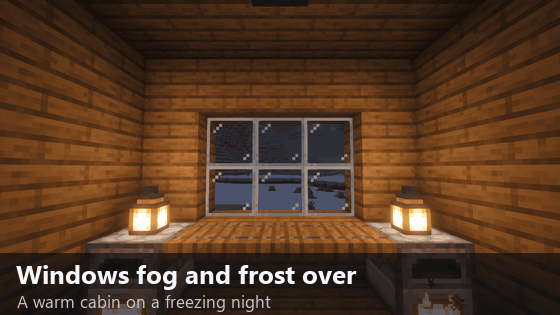
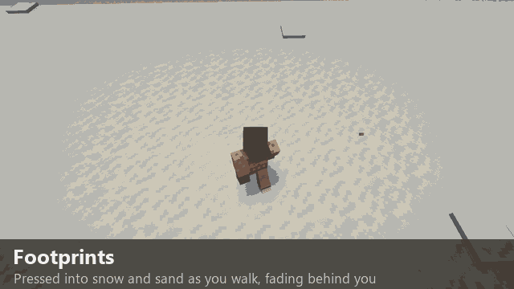
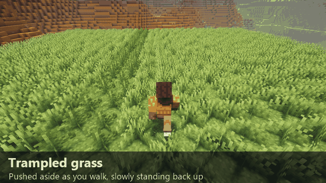
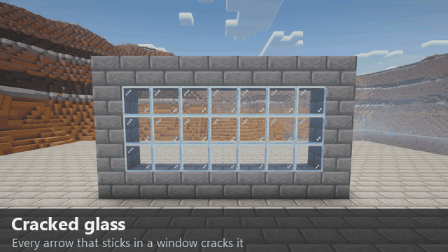
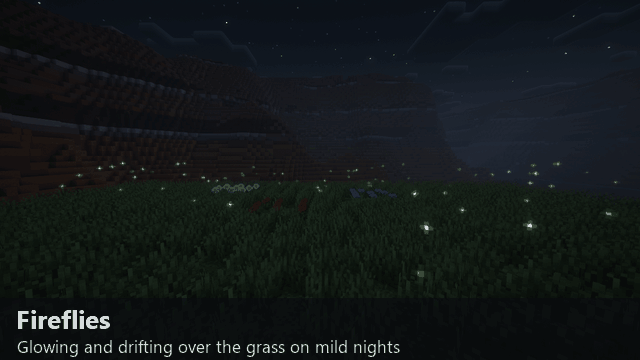

# Residuum

**The world remembers what happened in it.** Windows fog and frost over in the cold, a blizzard drives snow onto your walls, explosions blacken what they tear open, arrows crack the glass they hit, and you leave footprints in the snow behind you.

Client-side only. No new blocks, no items, no crafting. Works on any server, in any world, with vanilla textures and with resource packs.

*Residuum was called Living Glass. Your settings carry over.*

---

## ❄️ Weather on your windows

Every pane of glass in the world reacts to the weather outside and the warmth inside.

- **Condensation:** a warm room in a cold biome fogs its windows, thickest along the frame and at the bottom. Thick fog gathers into drops that run down and wipe a trail through it.
- **Frost:** below freezing, feathery crystals creep in from the frame.
- **Outside ice:** in a snowfall, and slowly on freezing nights, ice grows up the outside of the glass.
- **Raindrops:** drops run down glass out in the rain; in a snowfall, flakes stick to it.
- **Desert dust:** in deserts a faint film of sand settles on the glass, with drifts along the bottom. Red in badlands.
- **Breath and wipe:** lean close to a cold window and your breath fogs it; right-click with an empty hand to wipe a spot clear.
- **Roof windows:** glass in a roof fogs and frosts underneath and gathers ice and dust on top.

Warmth comes from lit furnaces, campfires, fire, lava, torches and players in the room. Cold depends on the biome, altitude, night and rain.

## 🌨️ Snow that stays

- **Snow on ledges:** in any snowfall, snow settles in clumps on the tops of stairs, slabs, fences, walls, doors and trapdoors, which vanilla snow leaves bare. It stays after the snowfall, like the snow on the ground.
- **Snow on walls:** in a blizzard (a thunderstorm in the snow), the wind drives snow onto the walls that face it, and a little onto those it blows along, even under the eaves. It lies on what you see of each block, not on its outline: the rails of a fence, only the solid pixels of a door. It runs on round corners and over edges, and falls away once the storm is over. The wind turns every ten minutes or so.
- **Hoarfrost:** on clear, freezing nights, grass and leaves out under the sky whiten with frost, which thaws in the morning sun.

## 👣 Traces of you

- **Footprints:** players and mobs press their prints into snow and sand: boots from people, paws from animals. They fade behind you.
- **Trampled grass:** grass and ferns you walk through are pushed aside, and spring back up half a second after you.

## 💥 Marks of what happened

- **Cracked glass:** an arrow or trident that sticks in glass cracks it, a web you can see from both sides. In other blocks it leaves a small hole.
- **Explosion soot:** TNT, creepers, end crystals and beds blacken the crater they leave and the walls round it.
- **Ash:** fire chars the block it burns on and leaves soot on the blocks around it.
- **Torch soot:** a torch smudges the underside of the block above it.
- **Lightning scorch:** a strike leaves a burn mark with glowing embers; on sand it melts into glass.
- **Snowball splats** on blocks and on raised shields, and **axe gashes** on a shield knocked aside.

## 🌙 Life in the world

- **Fireflies:** on mild, dry nights they glow and drift over grass and flowers, away from torches. Green-blue in cool biomes, amber in hot ones. They come out as night falls and leave at dawn.
- **Tumbleweeds** roll across deserts and badlands, hopping and kicking up dust.
- **Steam** rises from water warmed by lava or magma nearby.

---

## ⚙️ Settings

A full settings screen, opened from Mod Menu or from Sodium's video settings:

- **Every effect can be switched off** and tuned: how much, how fast it comes and goes, how far it reaches.
- **A live preview** beside every setting shows what it does, drawn with the mod's own textures.
- **Presets:** Subtle, Standard, Maximum and Low-end PC, one click each.
- **Search, undo (Ctrl+Z), a list of what you changed,** and Shift to see a setting's default.
- **Share your settings** as one line of text.

## 🔧 Compatibility

- **Minecraft 1.21.9 to 26.3**, Fabric Loader and Fabric API.
- **Sodium** and **Iris shaders:** work. All of the GIFs above are recorded with Complementary Reimagined.
- **Weather Glass, Interactive Foliage, Soft Imprints:** if one is installed, Residuum leaves that effect to it. A switch in the settings takes it back.
- Connected-glass resource packs, and packs that retexture snow: effects follow them.

## 📋 Every feature at a glance

All are on by default, and each has its own switch in the settings.

| Feature | When and where | How long (default) | Can tune |
|---|---|---|---|
| Condensation | Inside windows of a warm room in a cold place | Fogs over in 40 s, clears in 25 s | Strength, build-up, clearing |
| Breath on glass | Leaning close to a cold window | A few seconds | On / off |
| Wiping | Right-click glass with an empty hand | Fogs again at the fog's pace | On / off |
| Frost | Inside windows, below freezing | Creeps in over 90 s, melts in 30 s | Build-up, melting |
| Outside ice | Outside of the glass in snowfall and on freezing nights | Grows over 3 min, 90 s on fogged glass | Build-up, both |
| Raindrops and snowflakes | Glass out in rain or snow | Dries in 20 s | Drying |
| Desert dust | Glass in deserts and badlands | Settles over 6 min | Strength, build-up |
| Roof windows | Glass in a roof | Like the windows | On / off |
| Stained glass tint | Fog on stained glass takes its color | Always | On / off |
| Snow on ledges | Stairs, slabs, fences, walls, doors, trapdoors, in any snowfall | Builds over 15 min, stays after | Stay or melt, build-up |
| Snow on walls | Walls facing the wind, in a blizzard | Builds over 15 min, falls away in 15 min | Blizzards only or any snowfall, amount, side walls, build-up, fall-away |
| Hoarfrost | Grass, leaves, moss and podzol under the sky, on clear freezing nights | Builds over 9 min, thaws by day | Build-up |
| Footprints | Players and mobs on snow and sand | Fade in 60 s | Mobs' prints, fading |
| Trampled grass | Grass and ferns you walk through | Springs back in half a second | On / off |
| Cracked glass | An arrow or trident stuck in glass | 3 min | Fading |
| Arrow holes | An arrow or trident stuck in any other block | Stays after it is pulled out, then fades | On / off |
| Explosion soot | Crater and walls round a blast | 4 min | Fading |
| Ash | The block fire burned on, soot around it | Fades in 2 min | Build-up, side soot, fading |
| Torch soot | Underside of the block above a torch | Builds while it burns, fades once it is gone | On / off |
| Lightning scorch | Where lightning strikes; sand melts to glass | 3 min | Fading |
| Snowball splats | Blocks and raised shields | 20 s | Fading |
| Shield gashes | A shield knocked aside by an axe | Fades as the shield comes back | On / off |
| Fireflies | Grass and flowers on mild, dry nights | Dusk to dawn | How many |
| Tumbleweeds | Deserts and badlands | Roll by now and then | How often |
| Steam | Water next to lava or magma | While they touch | On / off |

Also in the settings: the climate (what counts as warm, how much night and rain cool things down, how far heat reaches), performance (scan radius and budget, drawing distance, tracked windows), a speed-up for testing snow, and the switches that leave an effect to Weather Glass, Interactive Foliage or a footprint mod.

Source: [github.com/w133y/living-glass](https://github.com/w133y/living-glass)
