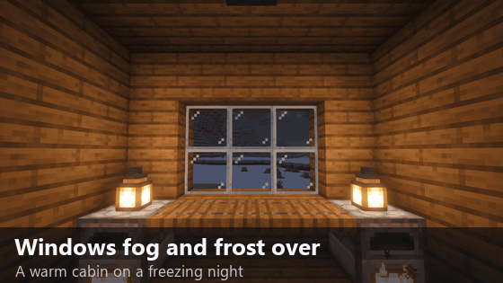
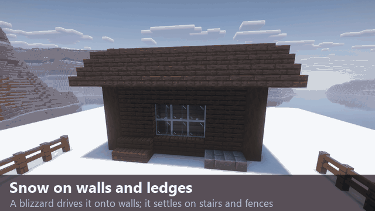
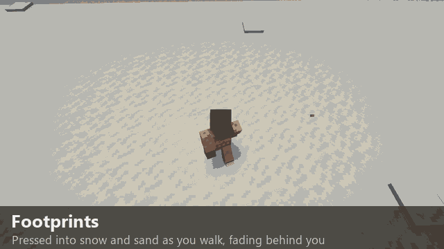
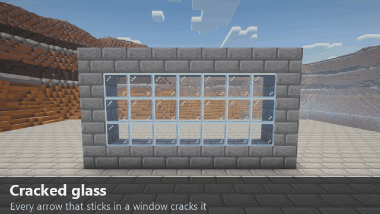
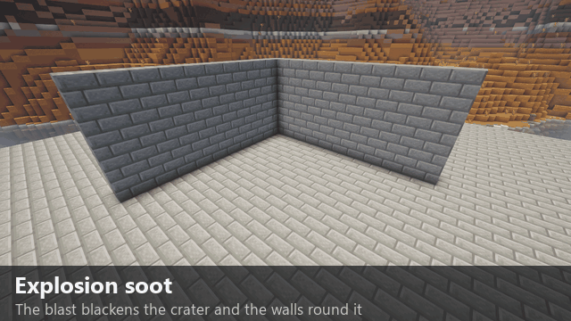
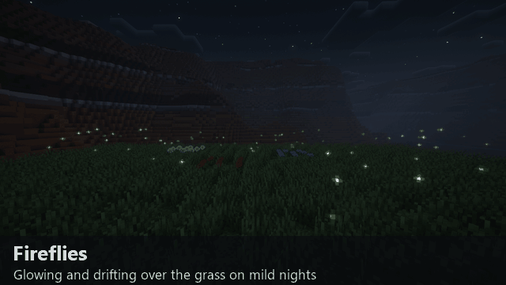
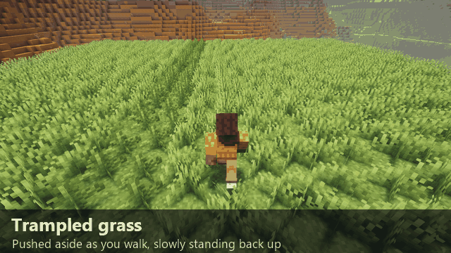

# Residuum

Client-side Fabric mod: **the world remembers what happened in it.** Windows fog and frost over in the cold, a blizzard drives snow onto your walls, explosions blacken what they tear open, arrows crack the glass they hit, and you leave footprints in the snow behind you. *Formerly Living Glass.*

No new blocks and no server install. Works on any server.

| | |
|---|---|
|  |  |
|  |  |
|  |  |
|  | |

All recorded with Iris and Complementary Reimagined.

## Features

- **Condensation:** a warm room in a cold biome fogs its windows, densest along the frame and at the bottom, warm in lamplight. Thick fog gathers into drops that run down and wipe a trail through it.
- **Frost:** below freezing, feathery crystals creep in from the frame.
- **Outside ice:** during snowfall, and slowly on freezing nights, feathery frost grows on the outside of the window from a little bank of snow at the bottom.
- **Torch soot:** a torch smudges the underside of the block above it with soot.
- **Tumbleweeds:** now and then a tumbleweed rolls across a desert or badlands, casting a shadow and kicking up dust where it lands; a hit breaks it up.
- **Trampled grass:** grass and ferns you walk through are pushed aside to either side of your way, and spring back up half a second after you.
- **Footprints:** players and mobs leave footprints in snow and sand that fade after a while.
- **Fireflies:** on mild, dry nights, specks of light glow and drift over grass and flowers, away from torches.
- **Cracked glass:** an arrow or trident that sticks in glass cracks it, seen from both sides; in other blocks it leaves a hole.
- **Hoarfrost:** frosty clear nights whiten grass and leaves out under the sky.
- **Snow on walls:** in a snowfall, walls facing the wind cake over with snow in patches.
- **Steam:** water heated by lava or magma nearby gives off wisps of steam.
- **Roof windows:** glass in a roof or ceiling over a room fogs and frosts underneath and gathers ice and dust on top.
- **Desert dust:** in deserts, a barely visible film of sandy dust covers the outside of windows, with a deposit along the bottom whose edge rises in sharp drifts, a little more at night. Red in badlands.
- **Ash:** fire leaves a black scorch on the block it burns on and soot on the blocks around it, which fades after the fire is out.
- **Snowball marks:** a thrown snowball leaves a splat wherever it hits for about 20 seconds.
- **Snow on ledges:** in any snowfall, snow settles on the tops of stairs, slabs, fences, walls, doors and trapdoors, which vanilla snow leaves bare, and stays after it.
- **Snow on walls:** in a blizzard (by default; a setting lets any snowfall do), the wind drives snow onto the walls facing it, a little onto those it blows along, even under the eaves; it lies on what is seen of each block and falls away after the storm.
- **Explosion soot:** TNT, creepers, end crystals, beds and other explosions blacken the crater they leave and the blocks around it in sight of the blast. Wind charges leave nothing.
- **Lightning scorch:** a strike leaves a burn mark with glowing embers on the ground around it, fading after a few minutes. On sand it melts into glass. A lightning rod it strikes crackles with little bolts for a while.
- **Raindrops:** drops run down glass exposed to rain and land on its top; in a snowfall, flakes stick to it. Glass under a roof stays dry.
- **Breath:** lean close to a cold window and your breath leaves a patch where you look.
- **Wipe:** right-click the glass with an empty hand to clear a spot. It slowly fogs up again.

Large windows act as one surface, round corners of glass too. Glass panes and stained glass are supported too.

Warmth comes from lit furnaces, campfires, fire, lava, torches and players in the room. Cold depends on the biome, altitude, night and rain.

## Requirements

- Minecraft 1.21.9 – 26.3
- Fabric Loader and Fabric API
- [Mod Menu](https://modrinth.com/mod/modmenu) (optional, opens the settings from the mod list)

## Settings

Five pages, by effect: Windows, Marks, World, Climate and Performance, each effect's switch with what tunes it, and a search box over them; before them ready-made presets (Subtle, Standard, Maximum, Low-end PC) and copying or pasting settings as one line of text, after them the settings changed from the defaults. Undo or Ctrl+Z takes changes back one by one, and Shift shows a setting's default in the preview. Every setting says what it does under its name, shows a reset arrow when changed, and has a live preview beside the list: a little window, wall, ceiling or field drawn with the mod's own textures that shows what the setting under the mouse (or picked with the keyboard) does as the settings stand, timings played ten times faster or more, so each build-up takes a few seconds; climate and performance settings get a diagram worked out from their values. Mod Menu opens this screen. With **Sodium** 0.8 or later (Minecraft 1.21.11 and up), Sodium's own video settings get a short Residuum page of the main switches, next to Sodium and Iris, and an **All settings** page that opens the full screen. Settings are saved to `config/residuum.json` (moved over by itself from `config/livingglass.json`).

There are keybinds to toggle the mod and a debug view, both unbound by default.

## Compatibility

- **Sodium:** works. Effects are an overlay; only trampled grass changes block models, through the Fabric Renderer API that Sodium supports, and only the chunk section of a plant that bends or rises is rebuilt.
- **Iris shaders:** no crash expected, but effects may look different.
- **Connected glass resource packs:** effects still line up.
- **Weather Glass, Interactive Foliage, Soft Imprints:** each draws something Residuum does too (weather on windows, bending grass, footprints). While one is installed, Residuum leaves that effect to it; a "Leave ... to" switch in the settings turns Residuum's own back on.

## Building

```
gradlew build -PmcVersion=26.3   # one version, see versions/
build-all.bat                    # every version into out/
```

## License

MIT
