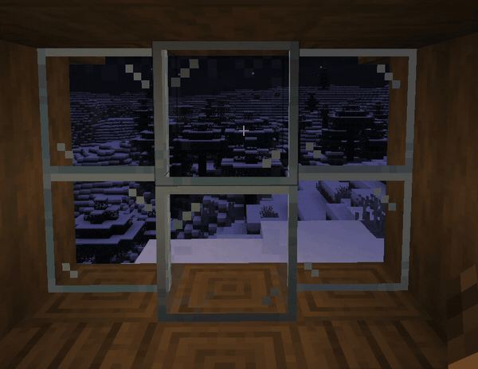
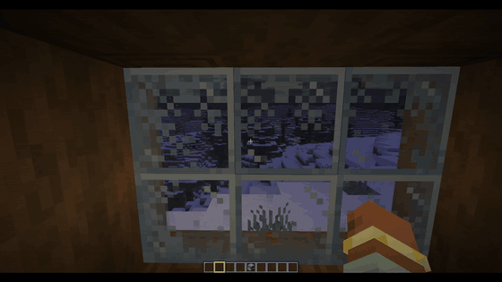
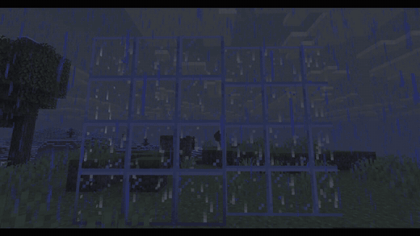
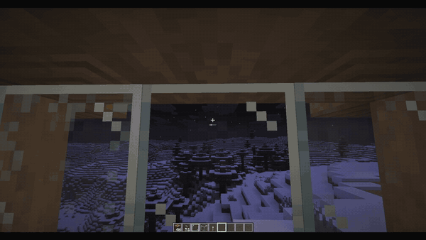

# Living Glass

Client-side Fabric mod that makes **vanilla glass react to the weather**. Windows fog up and frost over when it is cold outside and warm inside, and raindrops run down the glass in the rain.

No new blocks and no server install. Works on any server.

| Frost creeping in from the frame | Wiping the glass with your hand |
|---|---|
|  |  |
| **Raindrops on the outside** | **Breath on a cold window** |
|  |  |

## Features

- **Condensation:** a warm room in a cold biome fogs its windows, densest along the frame and at the bottom.
- **Frost:** below freezing, crystals creep in from the frame.
- **Outside ice:** during snowfall, feathery frost grows on the outside of the window from a little bank of snow at the bottom.
- **Ash:** fire leaves a black scorch on the block it burns on and soot on the blocks around it, which fades after the fire is out.
- **Snowball marks:** a thrown snowball leaves a splat wherever it hits for about 20 seconds.
- **Lightning scorch:** a strike leaves a burn mark with glowing embers on the ground around it, fading after a few minutes. On sand it melts into glass.
- **Raindrops:** drops run down glass exposed to rain and land on its top. Glass under a roof stays dry.
- **Breath:** stand right at a cold window and your breath leaves a patch.
- **Wipe:** right-click the glass with an empty hand to clear a spot. It slowly fogs up again.

Large windows act as one surface. Glass panes and stained glass are supported too.

Warmth comes from lit furnaces, campfires, fire, lava, torches and players in the room. Cold depends on the biome, altitude, night and rain.

## Requirements

- Minecraft 1.21.9 – 26.3
- Fabric Loader and Fabric API
- [Mod Menu](https://modrinth.com/mod/modmenu) (optional, for the settings screen)

## Settings

Everything is in Mod Menu: each effect can be switched on and off, and sliders cover timing, climate and performance. Settings are saved to `config/livingglass.json`.

There are keybinds to toggle the mod and a debug view, both unbound by default.

## Compatibility

- **Sodium:** works. Effects are an overlay, and chunks and block models are left untouched.
- **Iris shaders:** no crash expected, but effects may look different.
- **Connected glass resource packs:** effects still line up.

## Building

```
gradlew build -PmcVersion=26.3   # one version, see versions/
build-all.bat                    # every version into out/
```

## License

MIT
